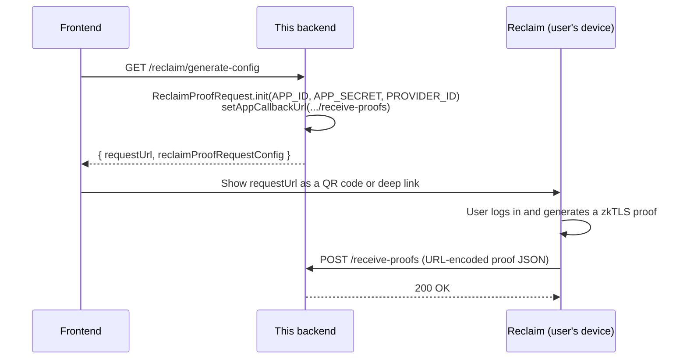

# reclaim-sdk-backend-demo

A minimal Express backend showing the server side of a [Reclaim Protocol](https://www.reclaimprotocol.org/) integration: it creates a proof request without exposing the app secret to the browser, and it receives the zkTLS proof the user's device sends back.


## Overview

Reclaim lets a user prove a fact from a website they're logged into, such as an account, a balance or a history, without sharing their credentials or the raw data. A proof request is signed with the app's **APP_SECRET**, so it should be created on a server, never in frontend code.

This repo is that server, in about 80 lines:

1. The frontend calls `GET /reclaim/generate-config`.
2. The backend builds a proof request with `ReclaimProofRequest.init(APP_ID, APP_SECRET, PROVIDER_ID)` and sets the callback URL. It returns the request URL (for a QR code or deep link) and a serialised config that the frontend can use to listen for the result.
3. The user completes the proof in the Reclaim flow, and Reclaim POSTs the proof to `POST /receive-proofs`.

## Flow



## Endpoints

| Method | Path | What it does |
|---|---|---|
| `GET` | `/reclaim/generate-config` | Creates a proof request and returns `{ requestUrl, reclaimProofRequestConfig }` |
| `POST` | `/receive-proofs` | Receives the proof body (URL-encoded JSON), parses it and replies `200`, or `400` if the body is invalid |

## Getting started

```bash
git clone https://github.com/Kushal7788/reclaim-sdk-backend-demo.git
cd reclaim-sdk-backend-demo
npm install
echo "APP_SECRET=<your Reclaim app secret>" > .env
npm start                      # http://localhost:3002
```

Before you run it:
- Replace `APP_ID` and `PROVIDER_ID` in `src/server.js` with your own, from the Reclaim developer portal.
- Point `setAppCallbackUrl(...)` at a URL Reclaim can reach. For local testing, a tunnel such as ngrok works.

On the frontend, the returned config can be loaded with `ReclaimProofRequest.fromJsonString(config)`, and you can then wait for the result with `startSession({ onSuccess, onError })`.

## Project structure

```
reclaim-sdk-backend-demo/
├── src/
│   └── server.js   # Express app: config generation and proof callback
└── package.json    # @reclaimprotocol/js-sdk, express, cors, dotenv, winston
```

## Notes

- **Verify proofs before trusting them.** This demo parses and acknowledges the proof but leaves processing as a `TODO`. In a real app, call `verifyProof(proof)` from `@reclaimprotocol/js-sdk`, check that the extracted claim matches what you asked for, and only then act on it.
- **Keep `APP_SECRET` server-side.** The secret is read from `.env` and never returned to the client. That separation is the main thing this demo shows.
- This demo targets `@reclaimprotocol/js-sdk` 2.x. Check the [Reclaim docs](https://docs.reclaimprotocol.org/) for the current API.

For more Reclaim use cases, see [reclaim-demos](https://github.com/Kushal7788/reclaim-demos): eight demo apps covering proof-gated bots, KYC-free lending and employment verification.
