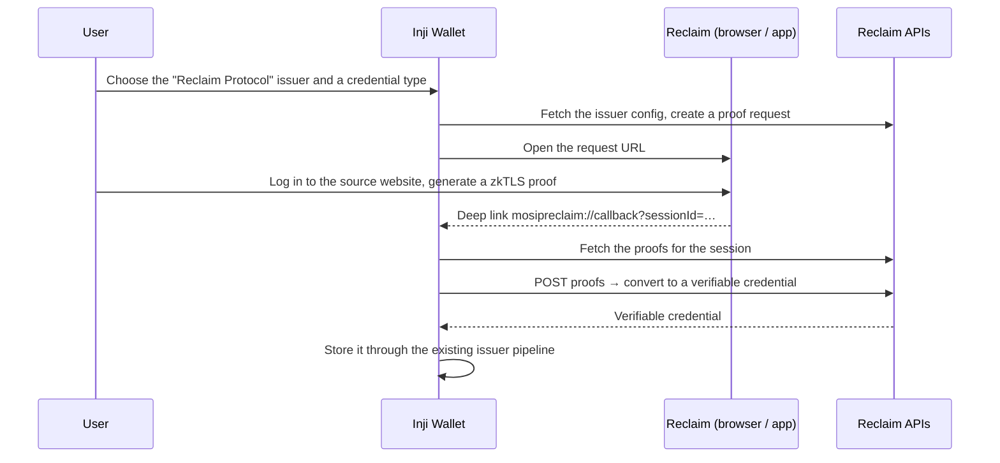

# Reclaim Protocol as a credential issuer in Inji Wallet

This integration adds [Reclaim Protocol](https://www.reclaimprotocol.org/) as a credential issuer in MOSIP's [Inji Wallet](https://github.com/inji/inji-wallet), a React Native digital-identity wallet. A user can turn a zkTLS proof of their web data into a verifiable credential and store it in the wallet next to government-issued ones.

**Built:** March 2025 · **Base:** [`inji/inji-wallet@432ff56`](https://github.com/inji/inji-wallet/commit/432ff568341c7f1352438e1c8ea3ff83888f0cc6) · **Change:** +371 / −23 across 10 files · **Diff:** [`reclaim-issuer-integration.diff`](reclaim-issuer-integration.diff)

## How it works



## What changed

| Area | Change |
|---|---|
| `shared/reclaim/ReclaimUtils.ts` (new, 252 lines) | The whole Reclaim flow: issuer detection, proof-request creation through `@reclaimprotocol/reactnative-sdk`, request URL generation, deep-link parsing, a 5-minute deep-link wait with listener cleanup, session proof fetching and proof-to-credential conversion |
| `machines/Issuers/*` (XState) | New guards (`isReclaimIssuer`, `isReclaimError`), a `RECLAIM_TIMEOUT` event and service branches, so Reclaim issuers take the new flow and every other issuer keeps the original path |
| `AndroidManifest.xml`, `Info.plist` | Registers the `mosipreclaim://callback` deep-link scheme on Android and iOS, alongside the wallet's existing `io.mosip.residentapp.inji` scheme |
| `package.json` | Adds `@reclaimprotocol/reactnative-sdk` ^2.2.0 |
| `.talismanrc` | Updates secret-scanner checksums for the changed files |

## Applying the diff

```bash
git clone https://github.com/inji/inji-wallet.git && cd inji-wallet
git checkout 432ff568341c7f1352438e1c8ea3ff83888f0cc6
git apply /path/to/reclaim-issuer-integration.diff
```

Inji Wallet is MIT-licensed. This diff modifies its source and is shared under the same license.
